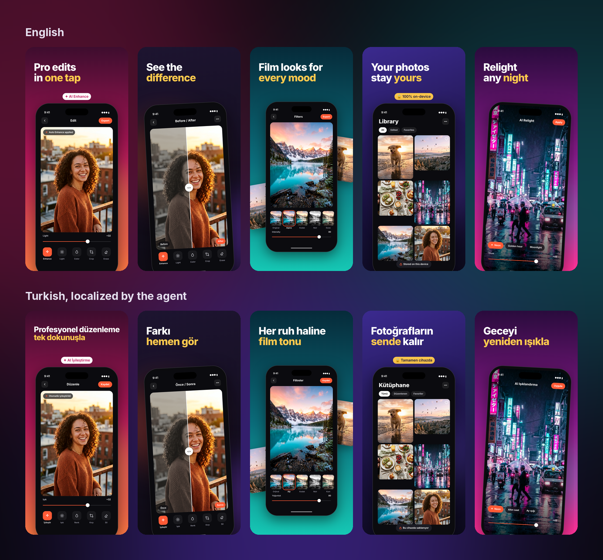
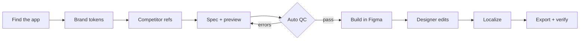

# Store Screenshot Agent

An AI agent that designs App Store and Google Play screenshot sets with you, checks them automatically, and builds them in Figma as real, editable layers.

It runs as a plugin for **Claude Code** and **Claude Desktop**. You talk to it in plain language ("make a 5-shot set for my photo editor, first three shots about speed, quality and privacy"), and it handles the rest: competitor research, layout, copy, preview, QC, Figma build, localization and export.



## Why

Store screenshots are usually made by hand in Figma, one language and one device size at a time. Every new locale means copying frames and fixing overflowing text. Every export means checking sizes and alpha channels against Apple's rules.

This agent keeps a single `spec.json` as the source of truth and generates everything from it. Designers still own the final look: they edit in Figma, and the agent reads their changes back before translating or exporting.

## What it does



- **Brand system.** Builds a color palette, color roles, typography, spacing and shadows as [W3C Design Tokens](https://www.designtokens.org/TR/2025.10/). Measures contrast, pushes everything to Figma as Variables and text styles, and exports CSS / Swift for developers.
- **Competitor research.** Pulls the current screenshot sets of competing apps from the store and lays them out on a contact sheet with a pattern table.
- **Spec and preview.** Renders every shot in a headless browser so you see the result before anything touches Figma.
- **Automatic QC.** Flags text that overflows its box, layers that collide, and text whose contrast against the pixels underneath is too low. A set with errors does not move on.
- **Native Figma build.** Real text layers, a vector iPhone frame, colors bound to brand Variables, text bound to text styles. Nothing is a flattened image.
- **Localization.** Clones the row the designer already polished, swaps in translated text and locale specific screens, shrinks text that does not fit, and reports what changed. Designer edits are kept.
- **Delivery.** Exports frames, strips transparency, writes iPhone 6.9" / 6.5" / 6.3" and iPad sizes, validates every file against store rules and produces a contact sheet.

## Skills

| Skill | Use it for |
|---|---|
| `find-app` | Pins down which app you mean. Checks your registry, then Figma, then the App Store, and asks you to confirm before using anything it found on the web. |
| `brand-system` | "Set up the brand system for Lumen", "pull the colors back from Figma", "check contrast" |
| `screenshot-set` | "New 5-shot set for Lumen", "analyze competitors", "build it in Figma" |
| `localize-screenshots` | "Make German and French versions of the set" |
| `deliver-screenshots` | "Export and get it ready for the App Store" |

## Requirements

- Claude Code or Claude Desktop
- A Figma account with a **Dev or Full seat** on a paid plan (needed to write to files; a View seat is read only)
- Node 18+ and Python 3 (the agent installs Playwright, Chromium, Style Dictionary and Pillow on first run)

The plugin ships with the official [Figma MCP server](https://github.com/figma/mcp-server-guide) connection. Claude asks for permission the first time it touches Figma.

## Install

**Claude Code**

```
/plugin install store-screenshot-agent --marketplace MertVkt/claude-store-screenshot-agent
```

On older versions: `/plugin marketplace add MertVkt/claude-store-screenshot-agent`, then `/plugin install store-screenshot-agent`.

**Claude Desktop**

Download [`store-screenshot-agent.plugin`](https://github.com/MertVkt/claude-store-screenshot-agent/raw/main/dist/store-screenshot-agent.plugin), drag it into a chat and click install.

Then tell Claude: **"set up the screenshot plugin"**. It installs the tools it needs once (a few minutes).

## Try it with the demo

The repo includes a fake demo app ("Demo Photo") with a brand file and a two-language, three-shot set.

> Try it with the example set and build it in this Figma file: `<link to an empty Figma file>`

## Project folder layout

Connect a folder where your screenshot projects live. The agent keeps this structure:

```
Projects/
├── _registry/apps.json        confirmed apps (name, code, store id, Figma links)
└── Lumen/
    ├── _brand/LMN.tokens.json brand tokens
    ├── _app/                  icon and current store set
    └── LMNSS01/               one set per concept
        ├── spec.json          single source of truth
        ├── Asset/screens/en-US/01.png ...
        ├── Ref.Shots/         competitor references
        ├── Work/              previews, Figma results, raw exports
        └── Final/             store-ready files
```

Each app gets a fixed three-letter code (`LMN`). Sets are numbered `LMNSS01`, `LMNSS02` and so on. Revisions and new languages stay in the same set; a new concept or a product page optimization test gets a new set.

## Ground rules the agent follows

- It never deletes, overwrites or renames an existing Figma frame, Variable or style without your explicit OK.
- Screens inside the device come from the real app. It does not draw or generate UI.
- Ratings, download counts and "#1" claims only appear with real data, and the source is written down.
- Nothing ships until the verification script passes.
- It does not generate paid AI images. Backgrounds and objects come from you.

## Limitations

- If Chromium cannot be installed, the agent uses Figma itself as the preview. Contrast checks are skipped in that case and it tells you.
- If images cannot be uploaded to Figma (network restrictions), layers stay as gray placeholders and the agent lists which file goes where.
- Fonts not installed in your Figma organization fall back to Inter, with a warning.

## Built with

[W3C Design Tokens 2025.10](https://www.designtokens.org/TR/2025.10/) (format) ·
[color.js](https://github.com/color-js/color.js) (MIT, palette and contrast) ·
[Style Dictionary](https://github.com/style-dictionary/style-dictionary) (Apache-2.0, developer output) ·
[Lucide](https://github.com/lucide-icons/lucide) (ISC, icons) ·
[Playwright](https://playwright.dev) (preview rendering) ·
[Figma MCP](https://github.com/figma/mcp-server-guide)

## License

MIT. See [LICENSE](LICENSE). Bundled third party code keeps its own license (`skills/screenshot-set/scripts/vendor/`).
